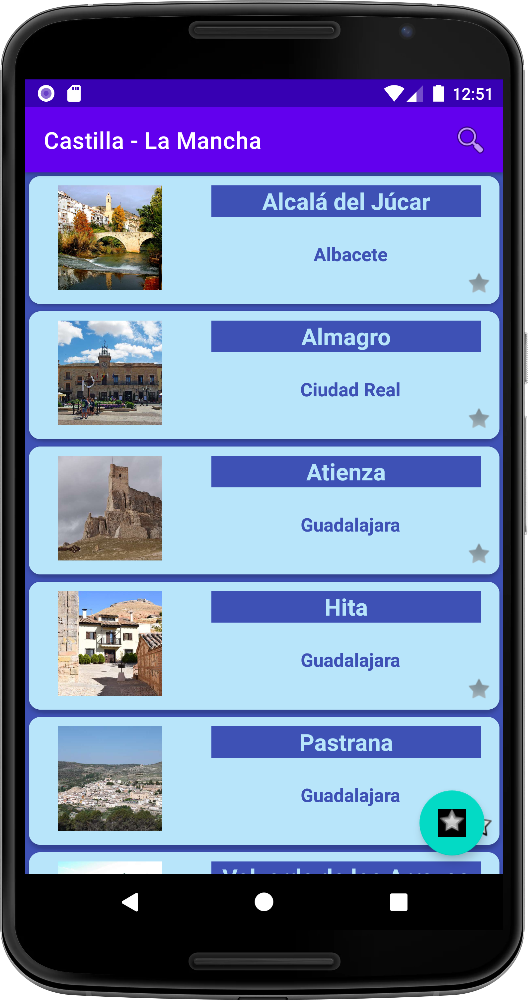
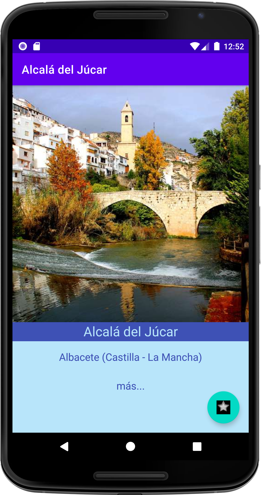
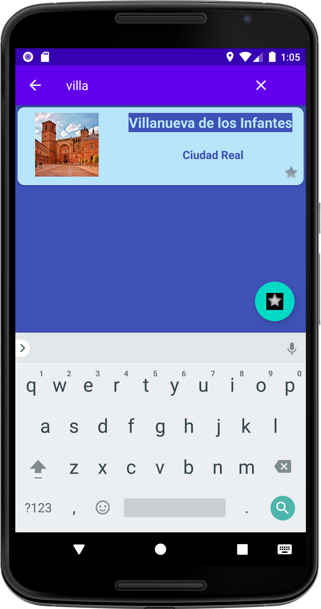
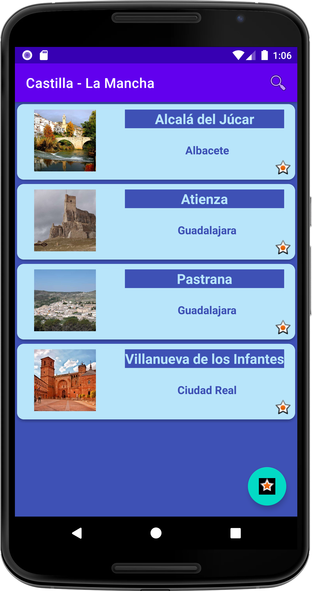
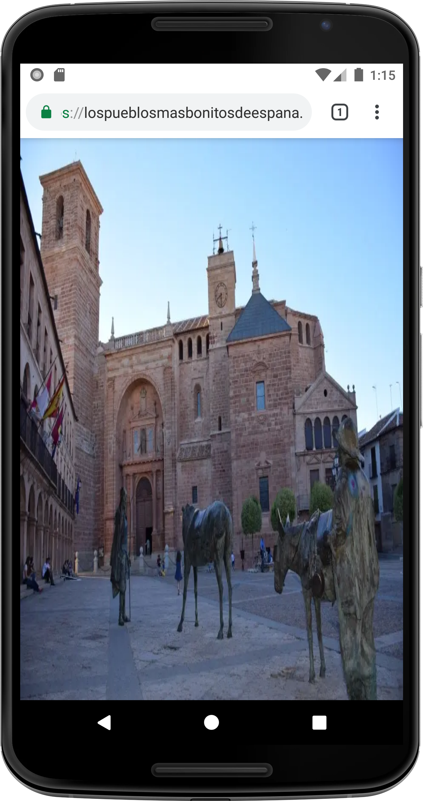
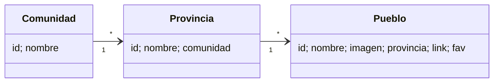

# 🏘️ Spain Villages — Beautiful Villages of Spain (Kotlin + Android)

An Android app to **browse the most beautiful villages of Spain**, grouped by autonomous community. Users can search villages, mark their favourites and open each village's official web page.

> 🎓 **Academic project.** Built as an exam project for the **Multimedia Programming and Mobile Devices** module (*Programación Multimedia y Dispositivos Móviles, PMDM*) of the **Higher Vocational Degree in Multiplatform Application Development** (*CFGS Desarrollo de Aplicaciones Multiplataforma, DAM*), 2nd year.

---

## 📸 Screenshots

| Communities | Villages | Village detail |
|---|---|---|
|  |  |  |

| Search | Favourites | Village web page |
|---|---|---|
|  |  |  |

---

## ✨ Features

- **Offline database** with **16 autonomous communities**, **42 provinces** and **105 villages**, available from the first launch.
- **Villages by community**: tap a community to see its villages with their province.
- **Search** by village name from the toolbar.
- **Favourites**: mark a village with the star button and filter the list to show only your favourites. Favourites are saved in the database.
- **Village detail** with its photo, province and community.
- **More info**: opens the village's web page inside the app.

---

## 🧰 Tech Stack

| Layer | Technology |
|---|---|
| Language | **Kotlin** |
| Platform | Android (minSdk 21, targetSdk 32) |
| Persistence | **Room** (SQLite) with `@Entity`, `@Dao`, `@ForeignKey` and `@Update` |
| Architecture | **MVVM**: `ViewModel` + `LiveData` + Repository |
| UI | `RecyclerView`, `SearchView`, `FloatingActionButton`, `WebView`, View Binding |
| Images | [`Picasso`](https://square.github.io/picasso/) |
| IDE / build | Android Studio (Gradle) |

---

## 🏗️ Architecture

| Screen | Responsibility |
|---|---|
| `MainActivity` | Copies the database on first launch and lists the communities. |
| `ActivityPueblos` | Lists the villages of a community, with search and a favourites filter. |
| `ActivityDetail` | Shows a village and lets the user mark it as favourite. |
| `ActivityDetailWeb` | Opens the village's web page in a `WebView`. |

### Implementation details

- **Pre-filled database**: `pueblosbonitos.sqlite` ships in `assets/` and `Util.inyecta()` copies it to the app's databases folder the first time the app runs, so Room opens it ready to use.
- **Joined query**: `PueblosDao` joins `pueblo` and `provincia` and returns a `PuebloView`, a class that adds the province name to each village.
- **Favourites**: stored in the `fav` column of each village and saved with Room's `@Update`.
- **Observed data**: lists are exposed as `LiveData`, so the UI refreshes when the database changes.

### Domain model



---

## 📁 Project Structure

```
spain-villages-android/
├── app/src/main/
│   ├── java/net/azarquiel/examenpueblos_ivangomez/
│   │   ├── adapters/          # Communities and villages RecyclerView adapters
│   │   ├── model/             # Room entities, DAOs, database and repositories
│   │   ├── util/Util.kt       # Copies the database from assets
│   │   ├── viewmodel/         # ViewModels
│   │   └── views/             # Activities
│   ├── assets/pueblosbonitos.sqlite
│   └── res/                   # Layouts, menu and values
├── screenshots/
└── build.gradle / settings.gradle
```

---

## 🚀 Running Locally

### Prerequisites
- Android Studio
- Android SDK 32
- An emulator or an Android device (Android 5.0+) with internet access

### Steps
1. Clone the repository:
   ```bash
   git clone https://github.com/ivangomezr/spain-villages-android.git
   ```
2. Open the project in Android Studio and let Gradle sync.
3. Press **Run ▶** and choose an emulator or a connected device.

> ⚠️ **About the data:** the villages are stored in the app, but their **photos and web pages are loaded from the internet**. If any of those links stop working, that photo or page will not load.

---

## 🙋 Author

**Iván Gómez** — [@ivangomezr](https://github.com/ivangomezr)

Developed as coursework for the *Multimedia Programming and Mobile Devices* module, DAM.